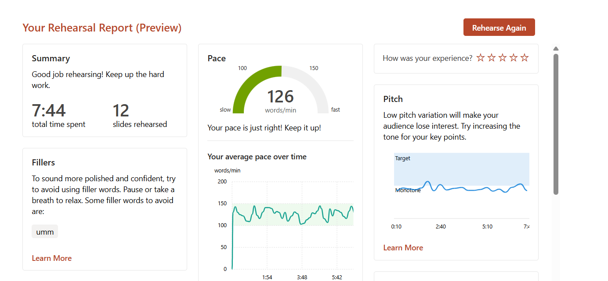
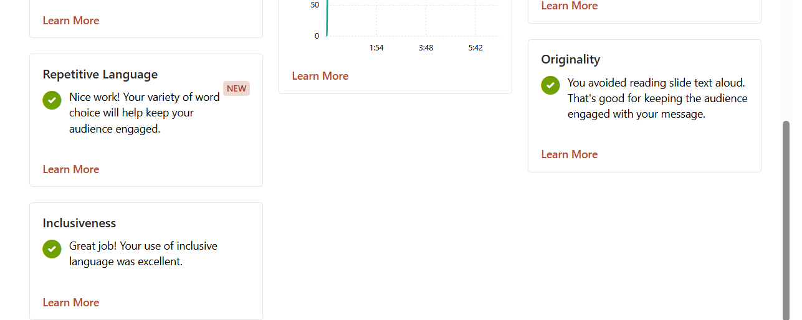

# Rehearsal Performance Analysis

## 1. Rehearsal Report Evidence

*Figure 1: Rehearsal overview showing overall timing (7:44), average pace (126 wpm), filler word tracking, and pitch variation graph.*

*Figure 2: Language breakdown highlighting originality, repetitive language check, and inclusiveness ratings.*

---

## 2. Performance Breakdown

### Strengths

* **Timing Compliance**: The rehearsal completed in **7:44** across all 12 slides, precisely matching the target duration of 7 to 8 minutes[cite: 7].
* **Speech Rate (Pace)**: Maintained an average pace of **126 words per minute**, staying steadily centered in the optimal 100–150 wpm range over the entire presentation[cite: 7].
* **Slide Engagement (Originality)**: Content was delivered spontaneously from talking points rather than read directly from the slide text[cite: 6].
* **Language & Delivery Choice**: Scored clean marks on repetitive language with sufficient vocabulary diversity, alongside appropriate inclusiveness[cite: 6].

---

### Areas for Improvement

* **Pitch Modulation**: The pitch curve stayed almost flat along the "Monotone" boundary rather than shifting into the target dynamic range[cite: 7].
* **Hesitation Fillers**: The filler word **"umm"** was recorded during transitions and pauses[cite: 7].

---

## 3. Targeted Adjustments for the Final Run

* **Vocal Emphasis on Key Parameters**: Inject deliberate emphasis by slightly raising pitch and projection when delivering the primary quantitative milestones:
  * *1500-byte MTU segmentation*
  * *0.2 ms intra-burst packet arrival time*
  * *60 fps frame rate cadence ($16.66\text{ ms}$)*
* **Strategic Pausing**: Substitute verbal hesitation (*"umm"*) with a deliberate 1-second silence when clicking through slide transitions or shifting focus between sections[cite: 7].
